# Estaleiro Pizzaria

Site de uma pizzaria de forno a lenha, feito com HTML5 e CSS3, sem JavaScript, para o trabalho final de Programação - Web Coding (Ciência da Computação, AV2).

## Integrantes

- Guilherme de Sousa e Silva
- Gabriel Ramos de Sousa
- José Claudionor Pereira da Silva Neto
- Gabriel da Silva Leal

## Páginas

| Página | Arquivo | CSS | Conteúdo |
|---|---|---|---|
| Início | `landing_page.html` | `LP.css` | Apresentação, diferenciais e história da casa |
| Cardápio | `p1.html` | `LP.css` e `p1.css` | Categorias, destaques e carta com preços |
| Sobre Nós | `p2.html` | `p2.css` | História, diferenciais e unidades |
| Contato | `p3.html` | `p5.css` | Montagem de pedido e canais de atendimento |
| Galeria | `p4.html` | `p4.css` | 17 fotos com filtro por categoria |

Os arquivos ficam em `trabalho_igor_main/site/`.

## Como abrir

Clone o repositório e abra a página inicial no navegador. Não há instalação.

```bash
git clone https://github.com/tialnic/Trabalho_Web_Coding.git
```

Arquivo inicial: `trabalho_igor_main/site/landing_page.html`. As fontes vêm do Google Fonts e precisam de internet.

## Organização dos arquivos

```
README.md
capturas/                 capturas de tela deste README
imagens/
trabalho_igor_main/
  site/
    landing_page.html
    p1.html  p2.html  p3.html  p4.html
    LP.css  p1.css  p2.css  p4.css  p5.css
    imagens/              fotos usadas pelas páginas
```

## Identidade visual

| Uso | Cor |
|---|---|
| Fundo | `#00152E` |
| Cards | `#002A57` |
| Cabeçalho e rodapé | `#003874` |
| Destaque | `#E3B103` |
| Texto | `#F4F5FA` |
| Texto secundário | `#B8C4D9` |

Títulos em Playfair Display e texto em Lato. As cores e fontes ficam em variáveis CSS no `:root`.

## HTML semântico

As páginas usam `header`, `nav`, `main`, `section` e `footer`. Os cards são `article`, e as fotos da galeria são `figure` com `figcaption`.

## Flexbox

| Onde | Classe | Arquivo | Função |
|---|---|---|---|
| Cabeçalho | `.header__principal-container` | todos os CSS de página | Logo de um lado e menu do outro |
| Menu | `.nav__lista` | `LP.css`, `p2.css`, `p4.css` | Links em linha, depois em coluna no celular |
| Lista de cards | `.diferenciais__lista` | `LP.css` | Quatro diferenciais com quebra de linha |
| Topo das páginas | `.hero__container` | `LP.css`, `p2.css`, `p4.css` | Texto e foto lado a lado |
| Botões do cardápio | `.cardapio-capa__acoes` | `p1.css` | Botões centralizados |
| Topo do contato | `.contato-hero__container` | `p5.css` | Texto e foto lado a lado |
| Filtros | `.filtros-galeria` | `p4.css` | Botões de categoria centralizados |

Exemplo com `display: flex`, `flex-direction`, `justify-content`, `align-items`, `flex-wrap` e `gap`: `.diferenciais__lista`, em `LP.css`.

## CSS Grid

| Onde | Classe | Arquivo | Recursos |
|---|---|---|---|
| Seção sobre | `.sobre__grid` | `LP.css`, `p2.css` | `grid-template-columns`, `grid-template-areas`, `gap` |
| Categorias | `.categorias__grade` | `p1.css` | 6 itens com `grid-template-areas`, `repeat()` e `minmax()` |
| Destaques do cardápio | `.cardapio__grade` | `p1.css` | `repeat(auto-fit, minmax())` |
| Carta | `.carta__grade` | `p1.css` | `repeat(3, minmax(0, 1fr))` |
| Unidades | `.unidades__grid` | `p2.css` | `grid-template-areas` |
| Pedido | `.pedido__grid` | `p5.css` | Duas colunas |
| Galeria | `.galeria__grid` | `p4.css` | 17 itens com `repeat()`, `minmax()` e `auto-fit` |
| Foto em destaque | `.galeria__item--destaque` | `p4.css` | Posicionamento por linhas com `grid-column` |
| Rodapé | `.footer__grid` | `LP.css`, `p2.css`, `p4.css`, `p5.css` | `repeat(auto-fit, minmax(240px, 1fr))` |

## Media queries

| Arquivo | Faixas | O que muda |
|---|---|---|
| `LP.css` | até 480 px, até 768 px, a partir de 769 px | Menu hambúrguer, topo empilhado, cards e seção sobre em 1 coluna no celular |
| `p1.css` | até 480 px, até 768 px, até 1024 px, a partir de 1200 px | Categorias passam de 4 para 2 e depois 1 coluna, e a carta vira 1 coluna |
| `p2.css` | até 480 px, até 768 px, a partir de 769 px | Diferenciais em 3, 2 ou 1 coluna e unidades empilhadas |
| `p4.css` | até 480 px, até 768 px, a partir de 769 px | Galeria em 3, 2 ou 1 coluna |
| `p5.css` | até 480 px, até 768 px | Formulário em 1 coluna e botões empilhados |

## BEM

As classes seguem o padrão `bloco__elemento--modificador`.

| Tipo | Exemplos |
|---|---|
| Blocos | `header`, `nav`, `hero`, `card`, `categorias`, `pedido`, `galeria` |
| Elementos | `nav__link`, `card__titulo`, `pedido__input`, `galeria__imagem` |
| Modificadores | `nav__link--ativo`, `card--destaque`, `botao--secundario`, `categorias__item--bebidas`, `galeria__item--forno` |

```html
<figure class="galeria__item galeria__item--forno">
    <div class="galeria__imagem-wrapper">
        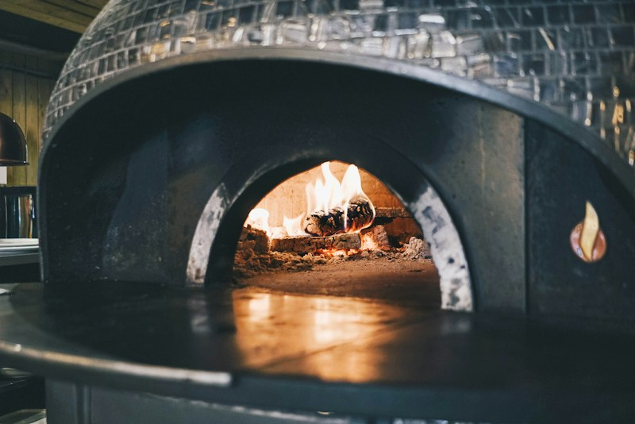
    </div>
</figure>
```

## Recursos só com CSS

- Menu hambúrguer com `input` do tipo checkbox e o seletor `~`.
- Filtros da galeria com botões de rádio, `:checked` e `:not()`.
- Aviso de erro ou confirmação do pedido com `:has()`, `:invalid` e `:target`. O pedido é demonstrativo e não é enviado.
- Estados `:hover` e `:focus-visible` em links e botões.

## Capturas de tela

### Início

| 375 px | 768 px | 1366 px |
|---|---|---|
| 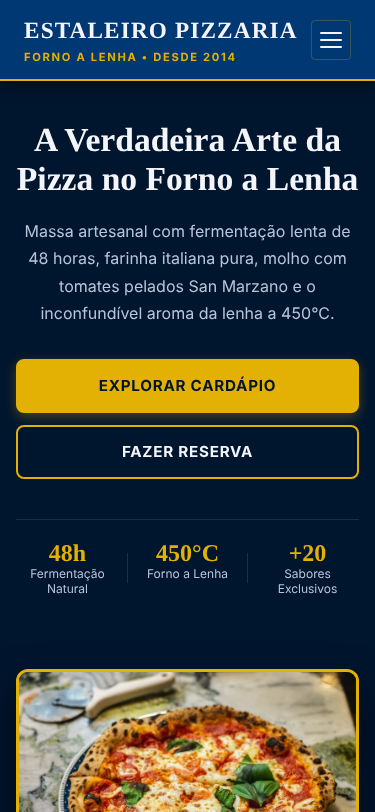 | 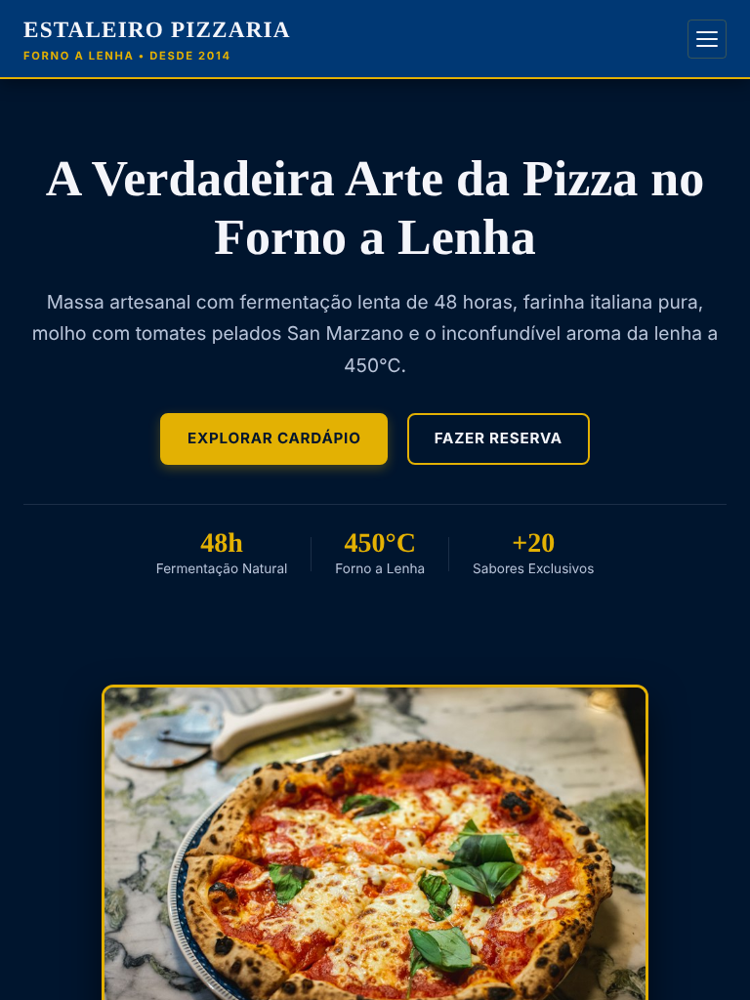 | 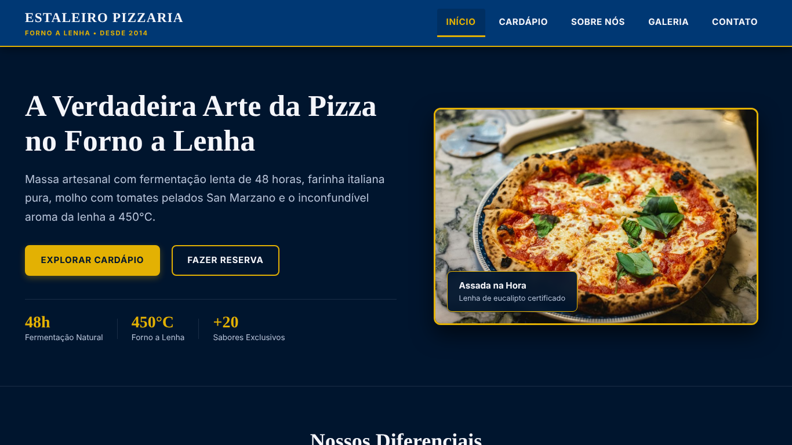 |

### Cardápio

| 375 px | 768 px | 1366 px |
|---|---|---|
| 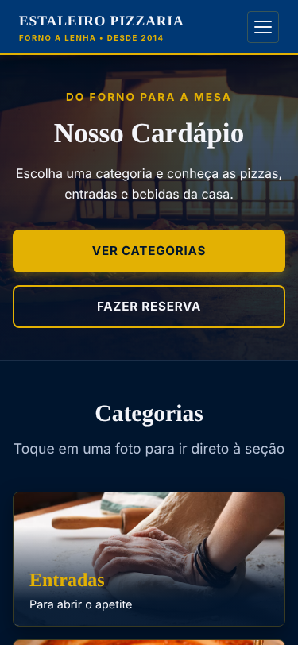 | 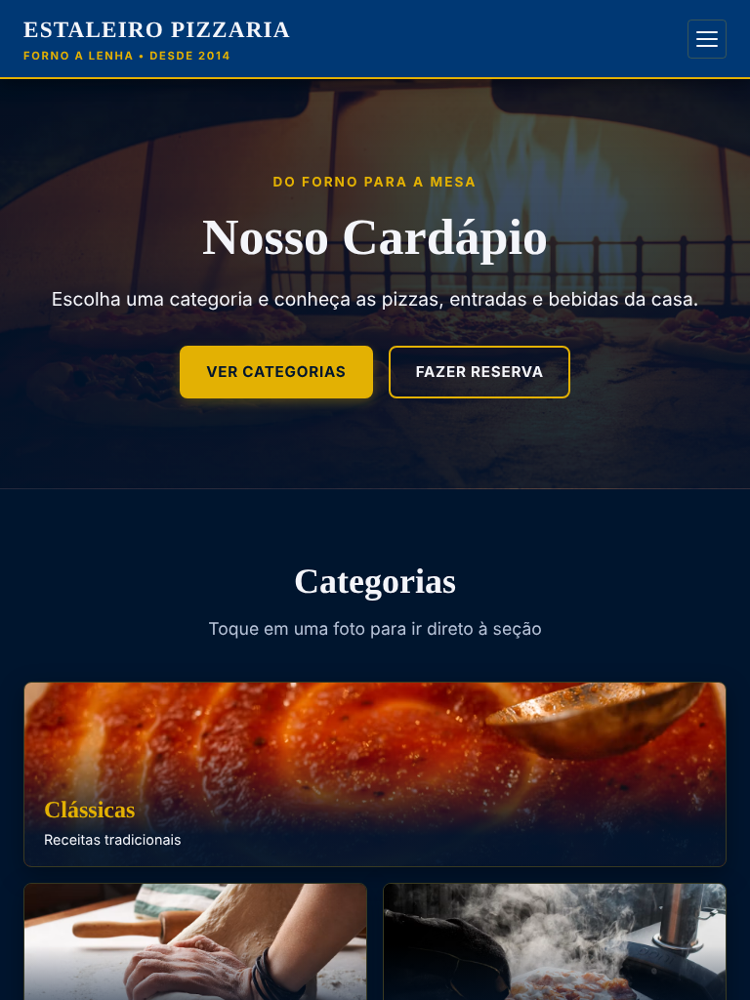 | 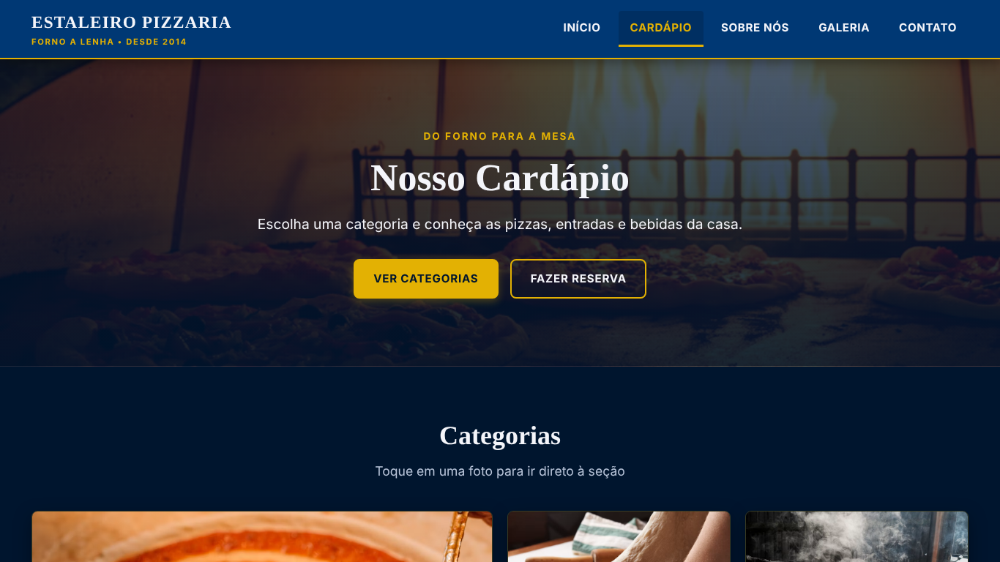 |

### Sobre Nós

| 375 px | 768 px | 1366 px |
|---|---|---|
| 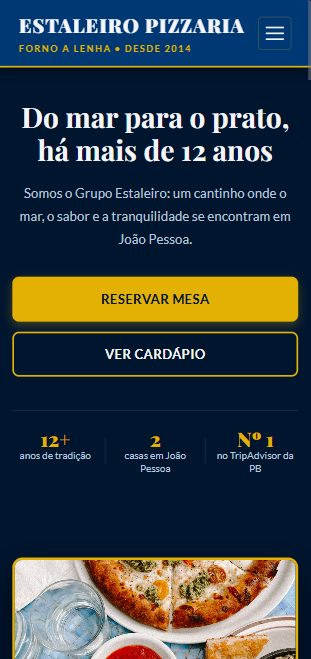 | 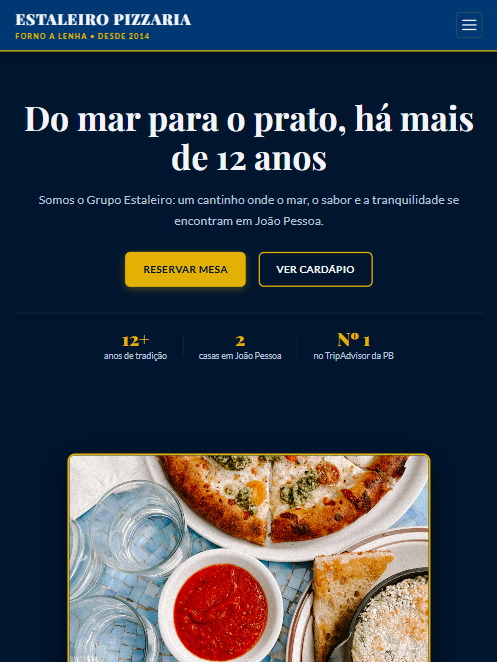 | 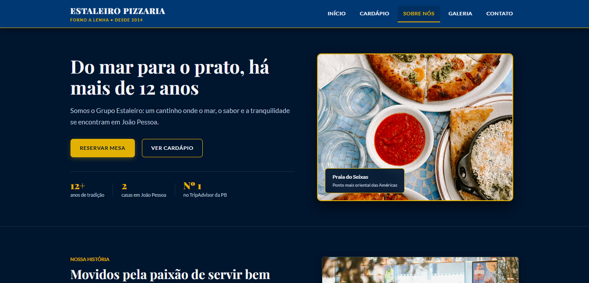 |

### Contato

| 375 px | 768 px | 1366 px |
|---|---|---|
| 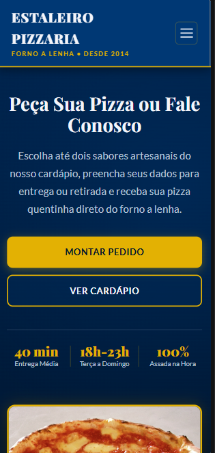 | 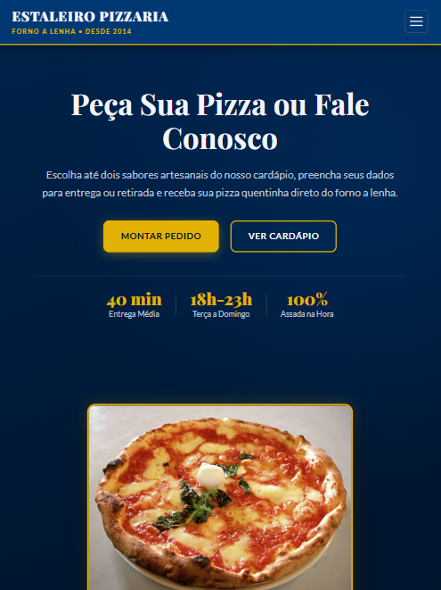 | 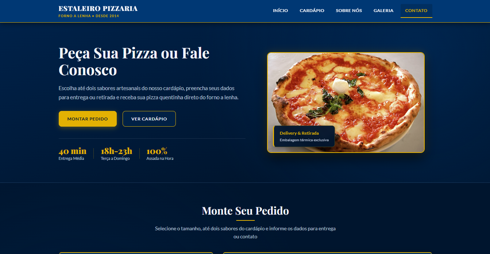 |

### Galeria

| 375 px | 768 px | 1366 px |
|---|---|---|
| 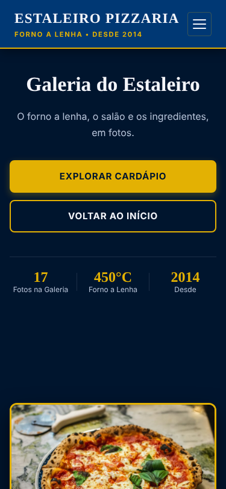 | 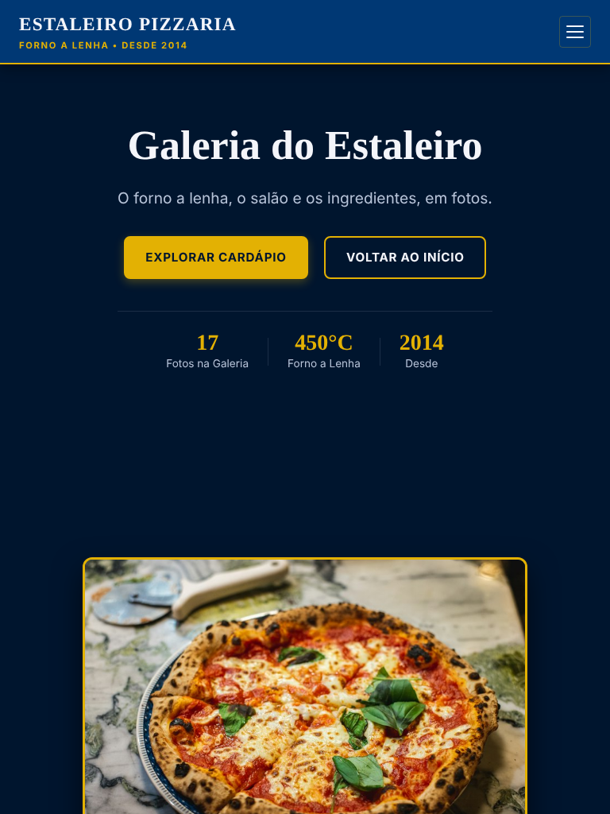 | 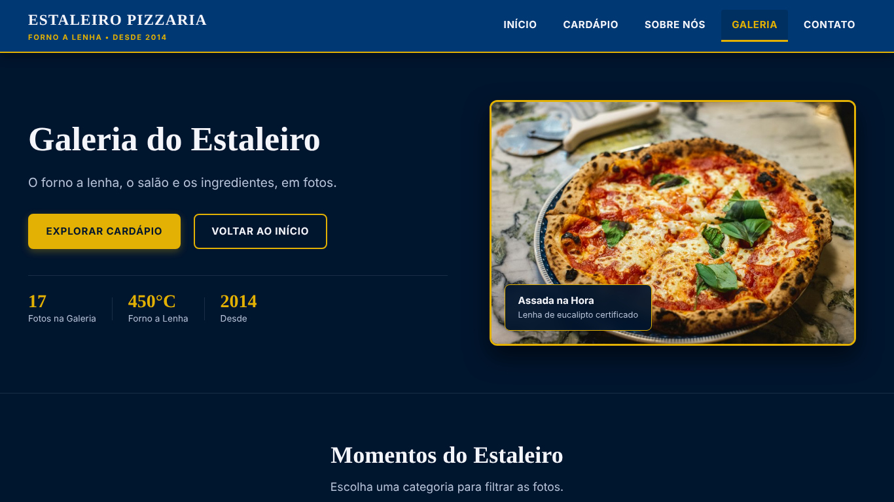 |

## Créditos

Fotos ilustrativas, do acervo do projeto, do [Unsplash](https://unsplash.com/license) e do Wikimedia Commons.
